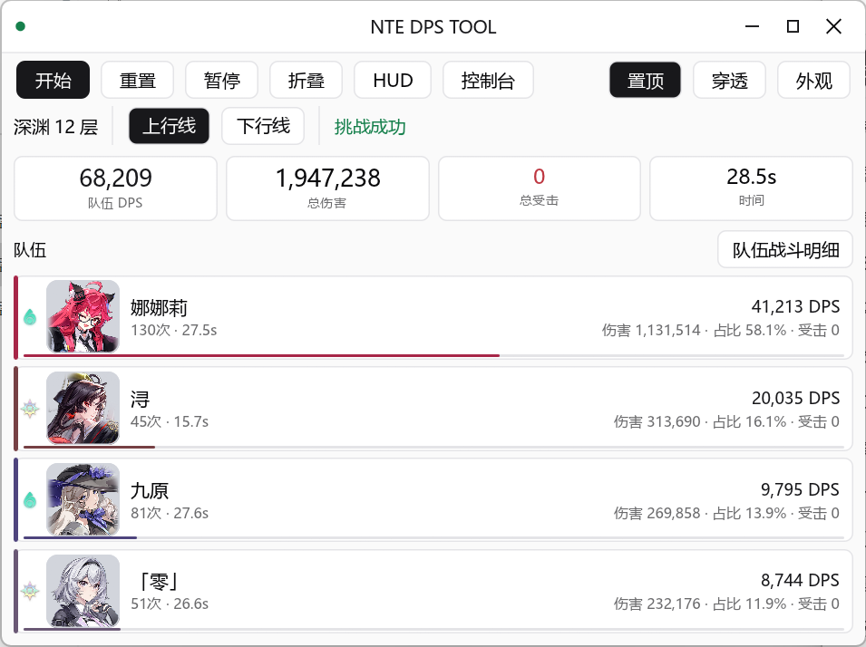
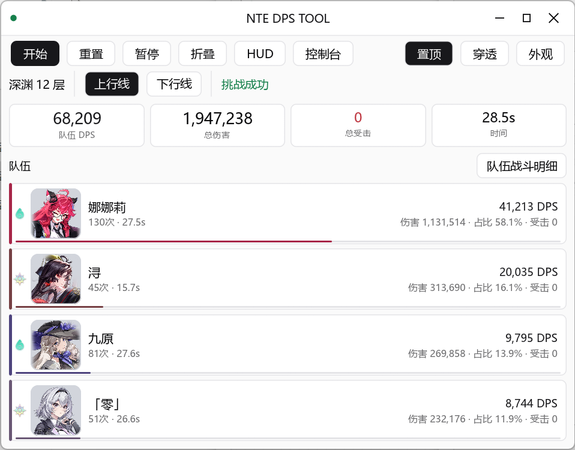
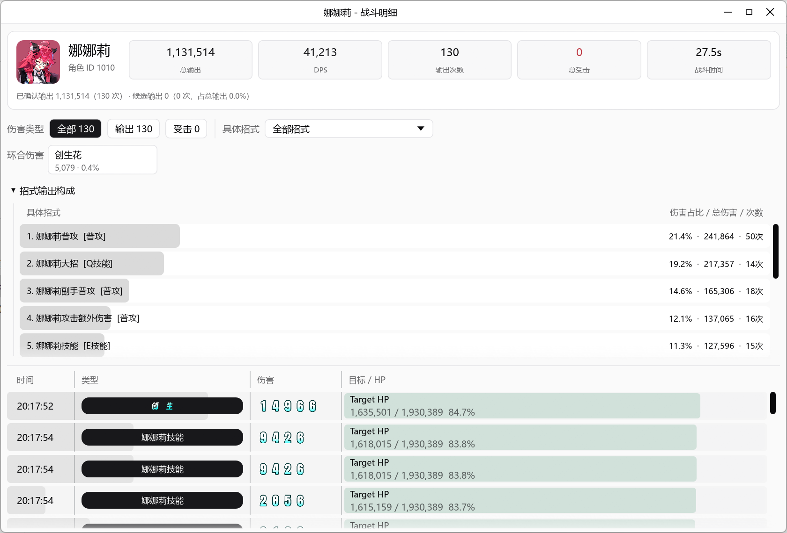
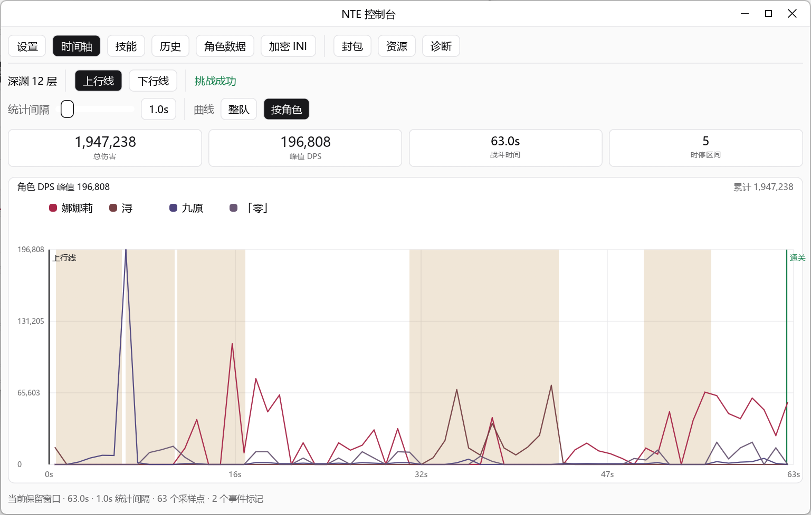
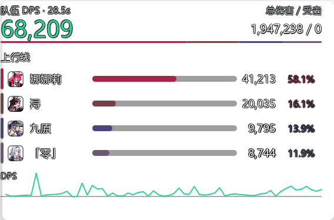
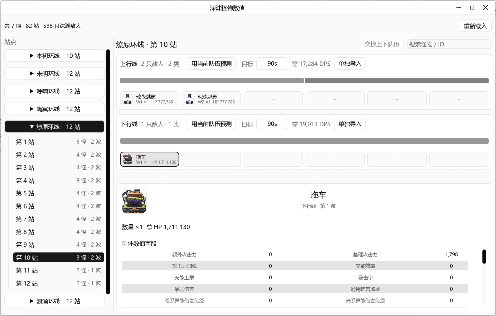

<div align="center">


# NTE DPS Toolkit

**《异环》战斗统计、复盘与配装工具**

**简体中文** · [English](README_EN.md)

[](https://github.com/kongbaiz/nte-dps-toolkit/releases/latest)
[](#快速开始)
[](LICENSE)

[下载 Windows 版](https://github.com/kongbaiz/nte-dps-toolkit/releases/latest) · [项目网站](https://dps.o-na-ni.com/) · [视频演示](https://www.bilibili.com/video/BV1YRNP6SEG5/) · [反馈问题](https://github.com/kongbaiz/nte-dps-toolkit/issues)

</div>

NTE DPS Toolkit 是面向 **Neverness to Everness（异环）** 的 Windows 桌面工具。战斗时查看队伍与角色输出，结束后通过技能明细、时间轴和历史对比复盘；也可以借助深渊分析、角色数据与空幕页面整理配装。

**默认使用抓包模式，原生插件按需启用。** 配置和战斗记录保存在本机，不需要注册工具账号。应用更新、Mod 市场和在线资源获取需要联网。

> 本项目由社区独立维护，与游戏开发商、发行商及相关权利方无从属、授权或背书关系。

<p align="center">
  
  <br />
  <sub>界面示例，实际布局与功能以所用版本为准。</sub>
</p>

## 功能一览

| 你想做什么         | 工具提供什么                                                                                                     |
| ------------------ | ---------------------------------------------------------------------------------------------------------------- |
| **边打边看输出**   | 队伍与角色 DPS、总伤害、伤害占比、命中数、受击与战斗时长；独立 HUD 支持置顶、透明度、鼠标穿透和布局调整。        |
| **找出伤害来源**   | 队伍与角色战斗明细、技能分类、逐次命中、技能占比和战斗时间轴。                                                   |
| **比较两次实战**   | 保存本地战斗摘要，回看历史记录，对比队伍、角色、技能与耗时。                                                     |
| **规划深渊挑战**   | 分别查看上下半场，查询怪物数据，用历史 DPS 估算清线时间或反推目标 DPS。                                          |
| **查看角色与配装** | 通过 User 插件读取角色、技能、觉醒和装备快照；空幕支持筛选、配装方案导入导出，以及可用时的锁定、弃置和穿戴操作。 |
| **管理可选插件**   | 在 Mod 市场下载和更新组件，在控制面板管理加载方式、连接状态及插件功能。                                          |
| **排查统计问题**   | 内置诊断、封包查看、JSON / PCAPNG 导入回放及导出。                                                               |

支持简体中文、English 与日本語。插件功能是否可用，取决于当前游戏版本、已加载组件和界面显示的能力状态。

## 快速开始

### 1. 下载并解压

在 [最新发布页](https://github.com/kongbaiz/nte-dps-toolkit/releases/latest) 下载 **`nte-dps-tool-windows-x64.zip`**，完整解压到可写目录，再运行 `nte-dps-tool.exe`。不要直接从压缩包内启动，也不要只取出单个 EXE。

运行环境：Windows 10 / 11 x64，以及 Microsoft Edge WebView2 Runtime。若提示缺少 WebView2，请先安装该运行时。

| 发布包                                        | 用途                                                             |
| --------------------------------------------- | ---------------------------------------------------------------- |
| **`nte-dps-tool-windows-x64.zip`**            | 普通用户首选。桌面程序、更新助手和内嵌资源。                     |
| `nte-dps-tool-windows-external-resources.zip` | 高级用户使用。资源放在独立的 `res/` 目录，其余用途与桌面版相同。 |
| `nte-core-windows-x64.zip`                    | 供第三方程序调用的无界面解析核心，不是桌面版。                   |

### 2. 开始第一场统计

推荐先使用默认的**抓包模式**：

1. 安装 [Npcap](https://npcap.com/)，建议启用 **WinPcap API-compatible Mode**。
2. 启动工具和游戏，确认首页数据来源为抓包模式。
3. 点击开始采集，进入战斗，查看主窗口或打开 HUD。
4. 战斗后进入控制台，查看技能、时间轴与历史记录。

遇到网卡枚举或抓包权限问题时，尝试以管理员身份运行工具，再到**控制台 → 诊断**检查 Npcap、网络连接与采集状态。

鼠标穿透默认使用 `Home` 切换；其他绑定可在**控制台 → 快捷键**中查看或调整。

## 选择数据来源

### 抓包模式：先用它开始统计

通过 Npcap 被动读取本机相关网络流量，不注入游戏、不修改游戏数据，也不向游戏发送数据。无需安装 UE Tools 插件，即可使用主要的伤害统计、历史复盘、深渊统计和回放功能。

抓包统计使用现实时间。游戏更新、网络环境与可解析的数据范围可能影响统计结果；没有数据时应先查看诊断信息。

### 插件模式：按需扩展

在首页切换到插件模式并阅读风险提示，然后进入**控制台 → Mod 工坊**：

1. 在 **Mod 市场**下载所需组件；有可用更新时，入口、分类与组件卡片会显示更新提示。
2. 在控制面板选择宿主加载方式：**代理**或 **Loader**。代理支持手动选择游戏目录，部署后需要重启游戏；Loader 按界面提示完成权限确认。
3. 确认宿主已连接、所需插件已加载，再开始采集或使用相应页面。**下载完成不等于加载完成。**

| 组件         | 主要用途                                                     |
| ------------ | ------------------------------------------------------------ |
| **Combat**   | 战斗采集与报告，以及界面提供的帧率解锁、快速大招等可选控制。 |
| **User**     | 角色与背包数据、角色配置快照，以及空幕中的装备操作。         |
| **Training** | 游戏内 `Tab` 木桩轮盘相关控制。                              |

插件组件从 Mod 市场单独下载，不内置于桌面发布包。公开仓库包含桌面客户端及集成代码，不包含 UE Tools、Loader 与原生插件源码。

插件模式不使用 Npcap。连接失败时不会自动切回抓包；切换数据来源后需要重新开始采集。插件计时会扣除可用的权威暂停区间，时钟不可用时显示降级状态并使用现实时间；历史记录保留保存时的计时口径。

代理模式提供卸载入口，需要先关闭游戏。卸载会核验部署文件归属，保留工具设置、已下载组件和无关文件；无法核验的文件不会直接删除。更多说明见[插件模式与部署](docs/PLUGIN_MODES.md)。

> 原生插件会加载到游戏进程，部分功能会与游戏交互，其技术与风险边界不同于被动抓包。请遵守游戏规则，自行判断是否使用；本项目不承诺任何模式绝对安全或不会受到游戏处罚。

## 界面与使用提示

<details>
<summary>查看战斗明细、时间轴、HUD 与深渊截图</summary>

| 队伍战斗明细                                         | 角色战斗明细                                              |
| ---------------------------------------------------- | --------------------------------------------------------- |
|  |  |

| 时间轴                                   | HUD                          |
| ---------------------------------------- | ---------------------------- |
|  |  |



</details>

- **比较 DPS 时先对齐口径。** 数据来源、计时方式、队伍与战斗场景不同，数字不宜直接横比。
- **深渊预测不是通关计时。** 估算基于怪物 HP 与历史 DPS，不包含无敌、转阶段、走位和机制耗时。
- **角色快照不是实时战斗面板。** 插件读取的是刷新时的角色配置；缺失、过期或未确认的数据以页面提示为准。
- **装备操作会影响游戏内配置。** 使用锁定、弃置、穿戴等功能前，请确认当前角色与目标装备。

## 本地数据与隐私

桌面程序把设置与数据保存在可执行文件旁，移动工具时请保留需要的目录：

```text
程序目录/
├─ nte-dps-tool.exe
├─ nte-updater.exe
├─ config.json        设置
├─ history/           战斗历史
├─ logs/              抓包与运行日志
└─ mods/              Mod 市场下载的组件
```

目录按使用情况生成。历史摘要用于保存脱敏统计，原始 PCAPNG 与诊断日志不是同一种数据；公开分享前请检查是否包含账号、网络地址或本机路径等敏感信息。**不要直接把整个 `logs/` 或程序目录上传到 Issue。**

## 常见问题

**有界面，但没有伤害数据？** 先确认所选数据来源。抓包模式检查 Npcap、游戏是否已进入战斗及诊断结果；插件模式检查宿主连接、Combat 加载状态及组件更新提示。安装成功不能替代连接确认。

**窗口无法点击？** 可能开启了鼠标穿透，按默认快捷键 `Home` 关闭；修改过绑定时以快捷键设置为准。

**下载了 `nte-core.exe`，为什么没有窗口？** 它是无界面 Sidecar。普通用户应下载桌面包并运行 `nte-dps-tool.exe`。

**角色数据或装备页面提示不可用？** 实时角色快照需要插件模式与 User 插件。先确认插件已加载，再按页面提示刷新；回放数据不等于当前游戏配置。

**如何反馈问题？** 在 [Issues](https://github.com/kongbaiz/nte-dps-toolkit/issues) 中说明工具版本、游戏区服/版本、数据来源、复现步骤和错误提示。优先附截图或脱敏摘要，原始抓包请先检查内容。

## 从源码构建

普通用户无需安装开发环境。开发者需要：

- Windows x64、Visual Studio 2022 Build Tools 的 C++ 桌面开发组件及 Windows SDK；
- Rust，通过 rustup 使用仓库 `rust-toolchain.toml` 指定的 **1.98.0**；
- Node.js **24**、pnpm **10**；
- WebView2 Runtime；运行抓包功能时另需 Npcap。

### 开发运行

```powershell
git clone https://github.com/kongbaiz/nte-dps-toolkit.git
cd nte-dps-toolkit
pnpm --dir frontend install --frozen-lockfile
pnpm --dir frontend tauri:dev
```

### 构建桌面版

```powershell
pnpm --dir frontend tauri:build --no-bundle --ci
cargo build --release --bin nte-updater --features desktop
```

桌面程序输出到 `src-tauri/target/release/nte-dps-tool.exe`，更新助手输出到 `target/release/nte-updater.exe`。需要外置资源时，给 Tauri 构建命令追加 `--features external_resources`，并在程序旁保留 `res/`。

桌面技术栈为 **Tauri 2 + React + TypeScript**，共享解析和业务逻辑由 Rust 提供。开发入口见[前端说明](frontend/README.md)，贡献约定与按影响选择的验证命令见 [AGENTS.md](AGENTS.md)。

### 第三方集成

`nte-core` 使用 **JSON-RPC 2.0 over NDJSON**：stdin 接收请求，stdout 输出响应与事件，stderr 输出诊断信息，不监听 TCP/HTTP 端口。

```powershell
cargo build --release --bin nte-core --no-default-features --features cli
.\target\release\nte-core.exe version --json
.\target\release\nte-core.exe serve --stdio
```

集成文档：[中文协议](docs/CLI_PROTOCOL_ZH.md) · [English protocol](docs/CLI_PROTOCOL.md) · [Python 示例](docs/examples/nte_core_client.py)。

### 发布构建

GitHub Actions 的 **Build** 工作流仅支持手动运行，不会因 push 或 Pull Request 自动触发。在仓库 **Actions → Build → Run workflow** 中选择分支；在 `master` 上执行会按工作流发布 Release，其他分支只生成构建产物。发布维护者需按[工作流配置](.github/workflows/build.yml)准备更新渠道变量及对应版本的[发布说明](docs/releases/)。

## 贡献与许可

欢迎提交问题、文档改进和代码贡献。请保持改动聚焦，并按 [AGENTS.md](AGENTS.md) 完成相关验证；不要提交本机配置、日志、抓包、密钥或完整解包资源。

本项目采用 **AGPL-3.0-or-later / 商业双重授权**，详见 [LICENSE](LICENSE) 与[授权说明](LICENSING.md)。第三方组件及游戏资源的许可与权利声明见 [THIRD_PARTY_LICENSES.md](THIRD_PARTY_LICENSES.md) 和 [NOTICE.md](NOTICE.md)。
