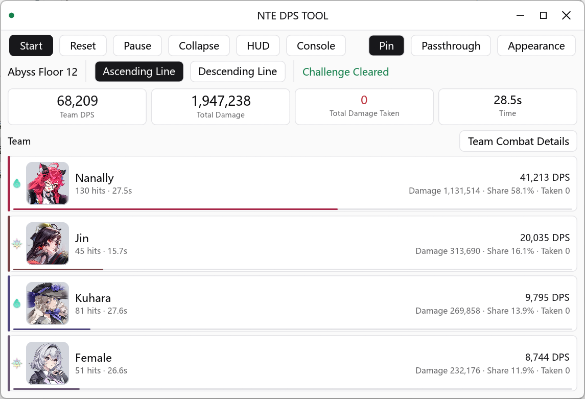
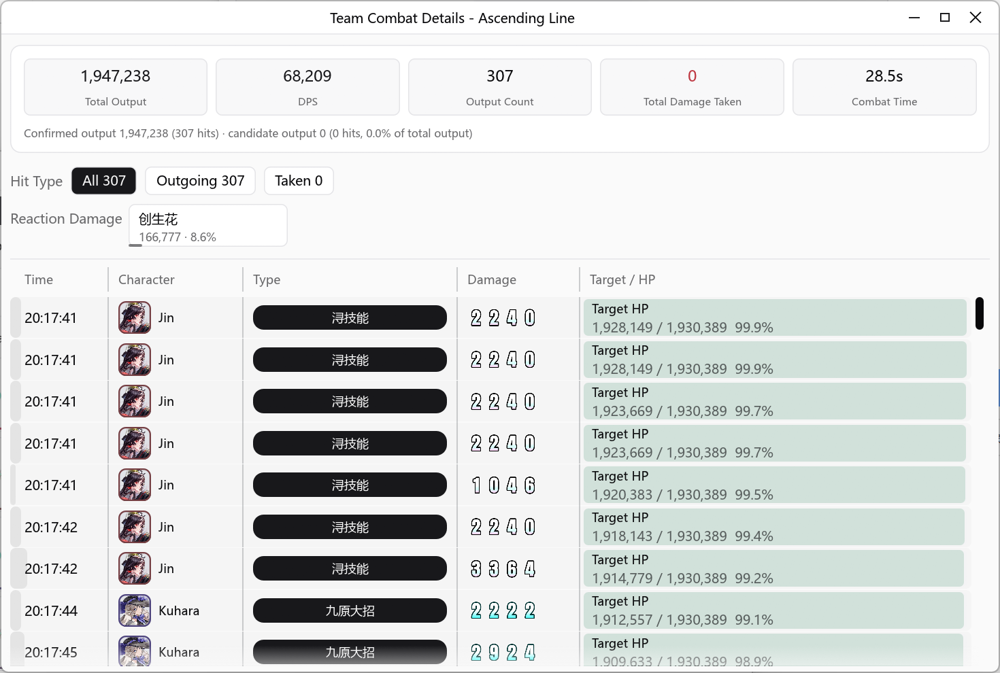
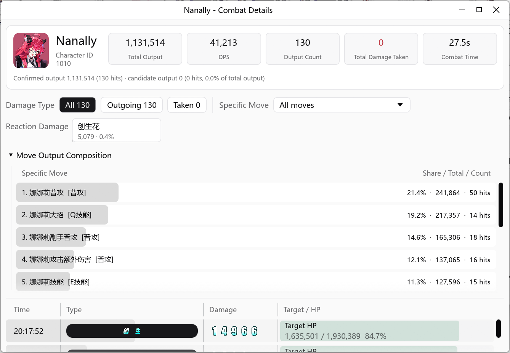
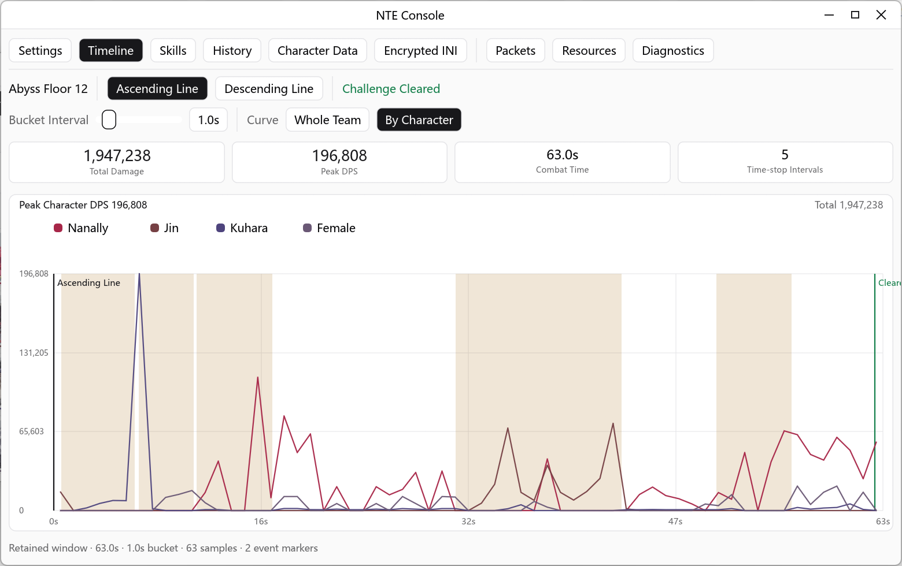
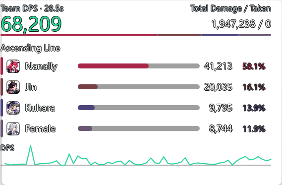
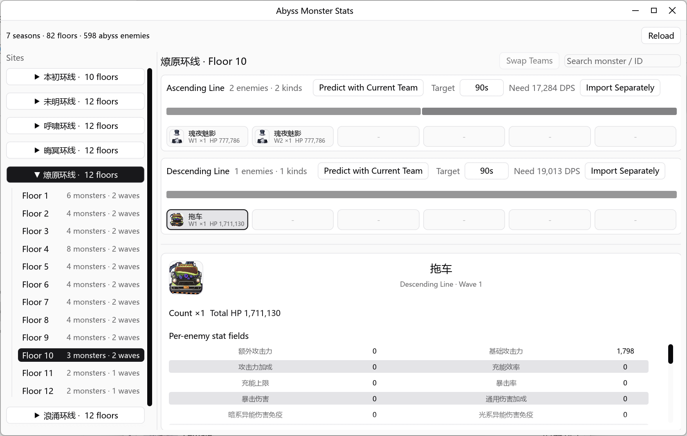

<div align="center">


# NTE DPS Toolkit

**Combat statistics, review and loadout tools for Neverness to Everness**

[简体中文](README.md) · **English**

[](https://github.com/kongbaiz/nte-dps-toolkit/releases/latest)
[](#quick-start)
[](LICENSE)

[Download for Windows](https://github.com/kongbaiz/nte-dps-toolkit/releases/latest) · [Project website](https://dps.o-na-ni.com/) · [Video demo](https://www.bilibili.com/video/BV1YRNP6SEG5/) · [Report an issue](https://github.com/kongbaiz/nte-dps-toolkit/issues)

</div>

NTE DPS Toolkit is a Windows desktop tool for **Neverness to Everness (NTE)**. Follow team and character damage during combat, then review skill breakdowns, timelines and saved runs. Abyss analysis, character snapshots and loadout tools help you prepare for the next fight.

**Packet capture is the default; native plugins are optional.** Settings and combat records are stored locally, with no toolkit account required. App updates, the Mod Market and online resources require an internet connection.

> This is an independent community project, not affiliated with, authorized by or endorsed by the game's developer, publisher or related rights holders.

<p align="center">
  
  <br />
  <sub>Example interface; layout and available features vary by version.</sub>
</p>

## Features at a glance

| What you want to do                 | What the toolkit provides                                                                                                                                                                             |
| ----------------------------------- | ----------------------------------------------------------------------------------------------------------------------------------------------------------------------------------------------------- |
| **Follow your damage live**         | Team and character DPS, total damage, damage share, hit counts, damage taken and duration. A separate HUD supports always-on-top, opacity, click-through and layout adjustments.                      |
| **Understand damage sources**       | Team and character hit details, skill categories, skill share and a combat timeline.                                                                                                                  |
| **Compare real fights**             | Save local combat summaries, revisit past runs and compare teams, characters, skills and timing.                                                                                                      |
| **Plan Abyss runs**                 | Review each half separately, inspect monster data, estimate clear time from historical DPS or calculate a target DPS.                                                                                 |
| **Inspect characters and loadouts** | Read character, skill, awakening and equipment snapshots through the User plugin. The loadout page supports filtering, loadout import/export and, when available, lock, discard and equip operations. |
| **Manage optional plugins**         | Download and update components in the Mod Market, then manage loading methods, connection status and plugin features in the control panel.                                                            |
| **Troubleshoot statistics**         | Built-in diagnostics, packet inspection, JSON / PCAPNG import, replay and export.                                                                                                                     |

The interface supports Simplified Chinese, English and Japanese. Plugin features depend on the game version, loaded components and capabilities reported in the UI.

## Quick start

### 1. Download and extract

Download **`nte-dps-tool-windows-x64.zip`** from the [latest release](https://github.com/kongbaiz/nte-dps-toolkit/releases/latest). Extract the entire archive to a writable folder, then run `nte-dps-tool.exe`. Do not launch it inside the archive or copy out only the main EXE.

Requirements: Windows 10 / 11 x64 and Microsoft Edge WebView2 Runtime. Install WebView2 if the application reports that it is missing.

| Package                                       | Intended use                                                                            |
| --------------------------------------------- | --------------------------------------------------------------------------------------- |
| **`nte-dps-tool-windows-x64.zip`**            | Recommended for most users. Desktop app, update helper and embedded resources.          |
| `nte-dps-tool-windows-external-resources.zip` | For advanced users. The same desktop app with resources in a separate `res/` directory. |
| `nte-core-windows-x64.zip`                    | Headless parsing core for integration with other software, not the desktop app.         |

### 2. Record your first fight

Start with the default **packet capture mode**:

1. Install [Npcap](https://npcap.com/), preferably with **WinPcap API-compatible Mode** enabled.
2. Launch the toolkit and the game. Confirm that the main window uses packet capture as its data source.
3. Start capture, enter combat and view the main window or open the HUD.
4. After combat, open Console to review skills, the timeline and saved history.

If adapter discovery or capture permissions fail, try running the toolkit as Administrator. Use **Console → Diagnostics** to check Npcap, network connections and capture status.

`Home` toggles click-through by default. Review or customize other bindings under **Console → Shortcuts**.

## Choose a data source

### Packet capture: start here

Npcap passively reads relevant local network traffic. This mode does not inject into the game, modify game data or send data to the game. The main damage statistics, history, Abyss statistics and replay features work without UE Tools plugins.

Packet statistics use wall-clock time. Game updates, network conditions and the available parsed data can affect results; check diagnostics when data is missing.

### Plugin mode: optional extensions

Switch to plugin mode in the main window, read the risk notice, then open **Console → Mod Studio**:

1. Download the required components from the **Mod Market**. Update indicators appear on the entry, categories and component cards when updates are available.
2. Choose a host loading method in the control panel: **Proxy** or **Loader**. Proxy mode supports manual game-directory selection and requires a game restart after deployment. Follow the permission prompts for Loader mode.
3. Confirm that the host is connected and the required plugins are loaded before starting capture or using their pages. **Downloaded does not mean loaded.**

| Component    | Main purpose                                                                                                        |
| ------------ | ------------------------------------------------------------------------------------------------------------------- |
| **Combat**   | Combat capture and reports, plus optional controls exposed in the UI, such as frame-rate unlock and quick ultimate. |
| **User**     | Character and inventory data, character configuration snapshots and equipment operations in the loadout page.       |
| **Training** | Controls for the in-game `Tab` wooden dummy wheel.                                                                  |

Plugin components are downloaded separately from the Mod Market, not bundled in desktop releases. This public repository contains the desktop client and integration code, not the UE Tools, Loader or native plugin source.

Plugin mode does not use Npcap. Connection failures do not silently switch back to packet capture; start capture again after changing data sources. Plugin timing deducts available authoritative pause intervals. When clock data is unavailable, the app shows degraded status and uses wall time. Saved history retains its original timing basis.

Proxy mode has an uninstall action that requires the game to be closed. It checks deployment ownership before removing files, retaining toolkit settings, downloaded components and unrelated files. Files whose ownership cannot be verified are not blindly deleted. See [plugin modes and deployment](docs/PLUGIN_MODES.md) for details in Chinese.

> Native plugins load into the game process, and some features interact with the game. Their technical and risk boundaries differ from passive capture. Follow the game's rules and decide whether to use them; the project does not guarantee that any mode is risk-free or exempt from game enforcement.

## Screenshots and usage notes

<details>
<summary>Show combat details, timeline, HUD and Abyss screenshots</summary>

| Team combat details                                         | Character combat details                                              |
| ----------------------------------------------------------- | --------------------------------------------------------------------- |
|  |  |

| Timeline                                      | HUD                          |
| --------------------------------------------- | ---------------------------- |
|  |  |



</details>

- **Align the basis before comparing DPS.** Data sources, timing, teams and combat scenarios can make direct comparisons misleading.
- **Abyss predictions are estimates, not clear timers.** They use monster HP and historical DPS, excluding invulnerability, phase transitions, movement and mechanic downtime.
- **Character snapshots are not live combat stats.** They reflect the character configuration at refresh time. Follow the page's indicators for missing, stale or unconfirmed data.
- **Equipment operations change in-game configuration.** Check the selected character and items before locking, discarding or equipping them.

## Local data and privacy

The desktop app stores settings and data beside its executable. Keep the directories you need when moving the toolkit:

```text
Application directory/
├─ nte-dps-tool.exe
├─ nte-updater.exe
├─ config.json        Settings
├─ history/           Combat history
├─ logs/              Captures and runtime logs
└─ mods/              Components downloaded from the Mod Market
```

Directories are created as needed. History summaries contain de-identified statistics; raw PCAPNG captures and diagnostic logs are different data. Check for account information, network addresses and local paths before sharing files publicly. **Do not upload the entire `logs/` folder or application directory to an issue.**

## FAQ

**The app opens, but no damage appears.** Check the selected data source first. In packet mode, verify Npcap, enter combat and inspect diagnostics. In plugin mode, check the host connection, Combat loading status and component updates. Installation alone does not confirm a connection.

**The window does not respond to clicks.** Click-through may be enabled. Press the default `Home` shortcut to disable it, or use your customized binding.

**Why does `nte-core.exe` have no window?** It is a headless sidecar. Download the desktop package and run `nte-dps-tool.exe` for the graphical app.

**Character or equipment data is unavailable.** Live character snapshots require plugin mode and the User plugin. Confirm that it is loaded, then refresh as instructed. Replay data does not represent the current game configuration.

**How do I report a problem?** Open an [issue](https://github.com/kongbaiz/nte-dps-toolkit/issues) with the toolkit version, game region/version, data source, reproduction steps and error message. Prefer screenshots or de-identified summaries; review raw captures before sharing them.

## Build from source

Regular users do not need a development environment. Developers need:

- Windows x64, Visual Studio 2022 Build Tools with Desktop development with C++, and a Windows SDK;
- Rust via rustup, using **1.98.0** as specified by `rust-toolchain.toml`;
- Node.js **24** and pnpm **10**;
- WebView2 Runtime, plus Npcap when running packet capture.

### Development

```powershell
git clone https://github.com/kongbaiz/nte-dps-toolkit.git
cd nte-dps-toolkit
pnpm --dir frontend install --frozen-lockfile
pnpm --dir frontend tauri:dev
```

### Build the desktop app

```powershell
pnpm --dir frontend tauri:build --no-bundle --ci
cargo build --release --bin nte-updater --features desktop
```

The desktop executable is written to `src-tauri/target/release/nte-dps-tool.exe`; the update helper is written to `target/release/nte-updater.exe`. For external resources, append `--features external_resources` to the Tauri build command and keep `res/` beside the app.

The desktop stack is **Tauri 2 + React + TypeScript**, with Rust providing shared parsing and application logic. See the [frontend guide](frontend/README.md) for development entry points and [AGENTS.md](AGENTS.md) for contribution rules and verification requirements.

### Third-party integration

`nte-core` uses **JSON-RPC 2.0 over NDJSON**: stdin for requests, stdout for responses and events, and stderr for diagnostics. It does not listen on TCP/HTTP ports.

```powershell
cargo build --release --bin nte-core --no-default-features --features cli
.\target\release\nte-core.exe version --json
.\target\release\nte-core.exe serve --stdio
```

Integration resources: [English protocol](docs/CLI_PROTOCOL.md) · [中文协议](docs/CLI_PROTOCOL_ZH.md) · [Python example](docs/examples/nte_core_client.py).

### Release builds

The GitHub Actions **Build** workflow runs manually only, not on pushes or pull requests. Select a branch under **Actions → Build → Run workflow**. Runs on `master` publish a Release according to the workflow; other branches produce build artifacts only. Release maintainers must configure the update-channel variables described in the [workflow](.github/workflows/build.yml) and provide [release notes](docs/releases/) for the package version.

## Contributing and licensing

Issues, documentation improvements and code contributions are welcome. Keep changes focused and run the relevant checks in [AGENTS.md](AGENTS.md). Do not commit local configuration, logs, captures, secrets or complete unpacked game assets.

The project offers **AGPL-3.0-or-later / commercial dual licensing**. See [LICENSE](LICENSE) and [LICENSING.md](LICENSING.md). Third-party components and game resources retain their own licenses and rights; see [THIRD_PARTY_LICENSES.md](THIRD_PARTY_LICENSES.md) and [NOTICE.md](NOTICE.md).
